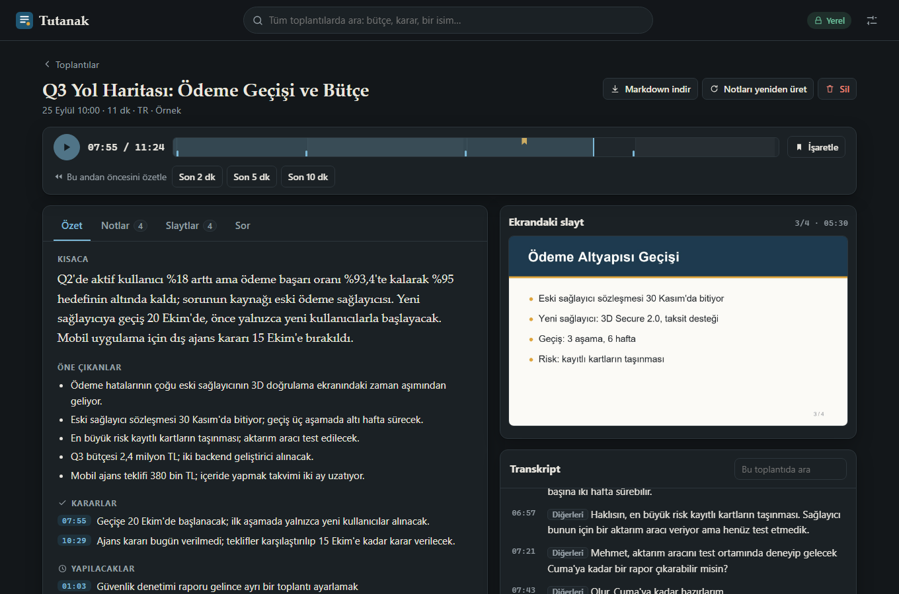

# Tutanak

[](https://github.com/MARRY45/tutanak/actions/workflows/ci.yml)

[](LICENSE)

Toplantıda dikkatin dağıldığında kaçırdığın yeri senin yerine tutan, tamamen yerelde çalışan
toplantı hafızası. Mikrofonu ve karşı tarafın sesini kaydeder, paylaşılan slaytları yakalayıp
okur, toplantı sürerken arka planda not alır. Sonra geçmişteki herhangi bir toplantının herhangi
bir anına dönebilirsin: kim ne dedi, o sırada ekranda hangi slayt vardı, ne karara bağlandı.

Ses, slayt ve notlar bilgisayarından çıkmaz. Bulut yok, hesap yok, toplantıya katılan bot yok.

> **English summary.** Tutanak ("minutes" in Turkish) is a local-first meeting memory. It records
> your microphone and the system audio, captures and OCRs the slides being shared, and takes
> notes in the background while the meeting runs. A "what did I miss?" button summarises the
> last few minutes on demand. Afterwards every meeting is a rewindable record: summary,
> decisions and action items each link to the second they were said, with the slide that was on
> screen. Search and question answering work across all past meetings. Speech recognition
> (faster-whisper), OCR and the language model (any OpenAI-compatible local server such as
> Ollama) all run on your machine; the model never writes a timestamp, code resolves and
> verifies every citation. Built with FastAPI, SQLite FTS5 and a no-build vanilla JS interface
> in Turkish or English.

**Stack:** Python · FastAPI · faster-whisper · SQLite FTS5 · Ollama (OpenAI uyumlu yerel LLM) · Pydantic · vanilla JS



## Neden bir toplantı notçusu daha?

Yerelde çalışan toplantı notçuları var; neredeyse hepsi yalnızca sesi yazıya döküp sonunda bir
özet çıkarıyor. Tutanak'ın derdi başka: **toplantı sırasında ve sonrasında kaçırdığın yere geri
dönebilmek.**

| | |
|---|---|
| **Slaytları da izler** | Ekranı izler, yalnızca yeni slayt geldiğinde görüntü alır, üzerindeki metni okur ve transkriptle aynı zaman çizelgesine yerleştirir. "Bu slayttayken ne söylendi?" tek tık. |
| **"Ne kaçırdım?"** | Toplantı sürerken son 2, 5 ya da 10 dakikayı özetler. Her madde söylendiği ana bağlıdır. |
| **Geriye sarılabilir kayıt** | Özet, karar, yapılacak ve not maddelerinin her biri bir zaman damgası taşır; tıklayınca ses o saniyeden çalar, o anki slayt açılır. |
| **Tüm geçmişte arama ve soru** | "Kart taşıma ne zaman yapılacaktı?" diye sor; cevap, hangi toplantının hangi dakikasında söylendiğine atıfla gelir. |
| **Ben / diğerleri** | Mikrofon ve sistem sesi ayrı izlenir; ek bir model olmadan kimin konuştuğu ayrılır. |

## Hemen dene

Mikrofon, model ya da internet gerekmez; iki örnek toplantıyla açılır:

```bash
git clone https://github.com/MARRY45/tutanak.git
cd tutanak
python -m venv .venv
```

Sanal ortamı etkinleştir (Windows: `.venv\Scripts\activate`, macOS/Linux: `source .venv/bin/activate`),
ardından:

```bash
pip install -e .
tutanak demo
```

Demodaki notlar hazır yapıştırılmış metin değildir. Betiklenmiş bir model gerçek bir modelin
vereceği türden yanıt verir; yanıtı doğrulayan, atıfları zaman damgasına çeviren, kararları
toplayan ve arama dizinini kuran kod gerçek toplantılardakiyle aynıdır.

## Nasıl çalışır

```
 mikrofon ──┐
            ├─► karıştırıcı ─► ses dosyası (her zaman, önce)
 sistem ────┘        │
                     └─► duraklamada kesme ─► Whisper ─► transkript ──┐
                                                                      ├─► birkaç dakikalık bloklar
 ekran ─► slayt değişimi algılama ─► OCR ─► slayt metni ──────────────┘          │
                                                                                 ▼
                                             yerel LLM: numaralı satırlardan not + atıf (satır no)
                                                                                 │
                              kod: atıfı doğrula ─► zaman damgası ─► özet, kararlar, yapılacaklar
                                                                                 │
                                                  SQLite: transkript, slaytlar, notlar, FTS5 dizini
```

## Tasarım kararları

- **Zaman damgasını model yazmaz.** Model, transkriptin numaralandırılmış satırlarını görür ve her
  not için dayandığı satırın numarasını verir. Numarayı saniyeye kod çevirir; parçada olmayan bir
  satıra yapılan atıf atılır. Küçük yerel modellerin uydurduğu "12:40'ta söylendi"ler böylece
  arayüze ulaşamaz.
- **Kararlar ve yapılacaklar yeniden yazdırılmaz.** Özet sayfasındaki karar, yapılacak ve açık soru
  listeleri blok notlarından kodla toplanır (yakın tekrarlar ayıklanır). Son LLM çağrısı yalnızca
  başlık, kısa özet ve öne çıkanları yazar; her madde söylendiği ana bağlı kalır.
- **Önce ses.** Ses, başka hiçbir şey ona dokunmadan diske başlıksız ham PCM olarak yazılır.
  Model yavaş kalsa, LLM çökse ya da elektrik gitse bile kayıt durur; bir sonraki açılışta yarım
  kalan toplantı kaldığı yerden tamamlanır.
- **Slayt, duran değişikliktir.** Küçültülmüş görüntü ızgara bloklarına bölünür. Blokların büyük
  kısmı değişip bir sonraki karede sabit kalıyorsa yeni slayttır. Video ve animasyon durulana kadar
  beklenir; köşedeki kamera görüntüsü gibi küçük ve sürekli değişen alanlar eşiğin altında kalır.
- **Saat tek.** Mikrofon, sistem sesi ve ekran aynı saate bağlıdır. Geç başlayan ya da susan bir
  cihaz sessizlikle doldurulur; "toplantının 754. saniyesi" üç kaynakta da aynı andır.
- **Arama Türkçe düşünülerek yazıldı.** Metin büyük/küçük harf ve aksandan arındırılarak dizinlenir
  (`ISI`, `ısı`, `isi` aynı), sorgular ön ek olarak eşleşir: `bütçe` yazınca `bütçeyi` ve
  `bütçesini` de bulunur. Yerel sunucuda gömme modeli varsa anlamsal sonuçlar da eklenir.
- **Model yoksa da çalışır.** LLM sunucusu kapalıysa kayıt, transkript, slaytlar ve anahtar kelime
  araması çalışmaya devam eder; notlar sonradan tek tıkla üretilir.
- **Transkript veridir, talimat değil.** Modele, toplantıda geçen "önceki talimatları unut" türü
  cümleleri uygulamaması, yalnızca not etmesi söylenir. Bu bir önlemdir, garanti değildir.

## Gizlilik

Bunlar söz değil, kodda zorlanan kurallar:

- **LLM adresi bu makinede olmak zorunda.** Loopback'e çözümlenmeyen bir adres reddedilir; yanlışlıkla
  yapıştırılan bir bulut adresi transkripti dışarı gönderemez. Bilerek açmak için ayarlarda ayrı
  bir onay kutusu vardır. Vekil sunucu (proxy) ortam değişkenleri yok sayılır.
- **Arayüz internetten hiçbir şey yüklemez.** Yazı tipi, betik, ikon: hepsi pakettedir ve
  `Content-Security-Policy` başlığı başka kaynağa izin vermez.
- **Sunucu yalnızca 127.0.0.1'i dinler.** Ayrıca `Host` başlığı yerel değilse (DNS rebinding) ve
  durum değiştiren istek başka bir kökenden geliyorsa (açık bir sekmedeki site kayıt başlatamasın
  diye) istek reddedilir.

Ağa çıkılan tek an ilk kurulumdur: Whisper modeli bir kez indirilir (Hugging Face) ve LLM'i
Ollama ile sen çekersin. Sonrası çevrimdışıdır. Her şey tek klasörde durur (`~/.tutanak`, ya da
`TUTANAK_HOME`); klasörü silmek her izi siler.

> Bir toplantıyı kaydetmeden önce katılımcılara haber ver. Kaydın yerelde kalması, kayıt için
> onay gerekliliğini (KVKK, GDPR ve benzeri) ortadan kaldırmaz.

## Kurulum

Python 3.10+ gerekir. Kayıtları içe aktarmak ve sesi sıkıştırmak için `ffmpeg`, not almak için
OpenAI uyumlu bir yerel model sunucusu ([Ollama](https://ollama.com), LM Studio, llama.cpp) gerekir.

```bash
pip install -e ".[all]"
ollama pull gemma3:4b
ollama pull bge-m3
tutanak doctor
tutanak
```

- `bge-m3` isteğe bağlıdır; anlamsal aramayı açar.
- `tutanak doctor` bu makinede neyin çalıştığını ve neyin eksik olduğunu listeler.
- NVIDIA ekran kartı için: `pip install -e ".[all,cuda]"`. Kart varsa `large-v3-turbo`, yoksa
  işlemcide `small` Whisper modeli seçilir; ayarlardan değiştirilebilir.
- Konuşma modeli ilk kayıtta indirilir. Önceden indirmek için: `tutanak download`.

Ayarlar arayüzden yapılır ve `settings.json` olarak saklanır; `TUTANAK_LLM_MODEL=qwen3:8b` gibi
ortam değişkenleri de geçerlidir.

## Kullanım

| Komut | Ne yapar |
|---|---|
| `tutanak` | Uygulamayı açar (`http://127.0.0.1:8765`). |
| `tutanak demo` | İki örnek toplantıyla, ayrı bir veri klasöründe açar. |
| `tutanak import kayit.mp4` | Ses ya da video kaydını toplantıya çevirir (videoda slaytlar da çıkarılır). |
| `tutanak list` / `tutanak export <id>` | Toplantıları listeler / birini Markdown olarak verir. |
| `tutanak download` | Konuşma modelini şimdi indirir. |
| `tutanak doctor` | Ses, ekran, OCR, ffmpeg ve model sunucusunu denetler. |

Arayüzde: **Kaydı başlat** ile mikrofon, sistem sesi ve istersen ekran kaydedilir. Toplantı
sürerken transkript ve notlar akar; **Ne kaçırdım?** son dakikaları özetler, **İşaretle** o anı
sonra bakmak üzere işaretler. Biten toplantıda zaman çizelgesi slaytları, işaretleri ve not
bloklarını gösterir; her zaman damgası tıklanabilir.

## Platform ve sınırlar

- **Yalnızca Windows 11'de denendi.** Sistem sesi WASAPI loopback ile, slayt metni Windows'un kendi
  OCR'ı ile okunur (Türkçe karakterler dahil). Linux'ta PulseAudio/PipeWire monitör kaynağı,
  macOS'ta BlackHole gibi bir loopback aygıtı gerekir; bu ikisi denenmedi.
- Windows dışında OCR için RapidOCR kullanılır; varsayılan alfabesinde Türkçe harfler yoktur
  (`ş`, `ğ`, `ı` yerine `s`, `g`, `i` okur).
- Konuşmacı ayrımı "ben / diğerleri" düzeyindedir; karşı taraftaki kişiler birbirinden ayrılmaz.
  Hoparlör kullanıyorsan mikrofon karşı tarafı da duyar; kulaklık önerilir.
- Canlı transkript konuşmanın 10-30 saniye gerisinden gelir (duraklama beklenir).
- Notların kalitesi yerel modele bağlıdır. Atıf doğrulaması uydurma zaman damgalarını engeller,
  yanlış anlaşılmış bir cümleyi engellemez.
- Tam ekran video paylaşımı ya da sürekli hareket eden ekranlar slayt olarak yakalanmaz. Aynı
  slayta tek bir madde eklenmesi gibi küçük değişiklikler yeni slayt sayılmaz.

## Durum

Erken sürüm (v0.1). Şu ana kadar neyin gerçekten denendiği:

- **Gerçek cihazda (Windows 11):** mikrofon + sistem sesi yakalama, iki kaynağın saatle
  hizalanması, duraklamada kesme, "ben / diğerleri" etiketi.
- **Gerçek dosyada:** seslendirilmiş örnek bir sunum videosundan slayt algılama (4 slaytın 4'ü,
  doğru saniyede) ve Türkçe OCR.
- **Betiklenmiş modelle ve otomatik testlerle:** not alma, atıf doğrulama, özet, arama,
  soru-cevap, API ve arayüz.
- **Henüz denenmedi:** gerçek bir Whisper modeliyle uçtan uca yazıya dökme ve gerçek bir yerel
  LLM ile not üretimi. Kod yolları hazır ve sahte bir model sunucusuna karşı sınanıyor; gerçek
  model çıktısının biçimi ve kalitesi doğrulanmadı.

## Geliştirme

```bash
pip install -e ".[dev]"
pytest
ruff check .
```

Testler mikrofon, ekran, GPU ya da model istemez: konuşma tanıma ve dil modeli yerine betiklenmiş
karşılıkları, ses yakalama yerine sahte bir kaynak kullanılır; `ffmpeg` gerektiren içe aktarma
testleri, `ffmpeg` yoksa atlanır.

```
src/tutanak/
  audio/     yakalama (mikrofon + loopback), duraklamada kesme, ffmpeg yardımcıları
  screen/    ekran yakalama, slayt değişimi algılama, OCR
  asr.py     faster-whisper
  llm.py     yerel OpenAI uyumlu istemci        netguard.py  yalnızca-yerel denetimi
  notes.py   blok notları, özet, "ne kaçırdım"  search.py    arama ve soru-cevap
  session.py canlı kayıt                        importer.py  dosya içe aktarma
  store.py   SQLite + FTS5                      server.py    FastAPI
  web/       arayüz (derleme adımı yok)
```

## Lisans

[MIT](LICENSE)
